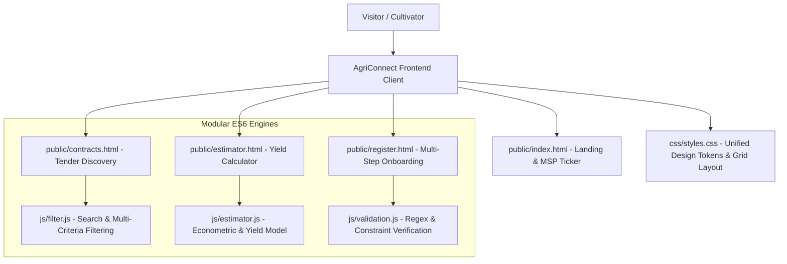

# AgriConnect — Stage 1 Academic Review Presentation Deck
## Milestone 1: Responsive Static Web Architecture & Modular Client-Side Scripting

---

### SLIDE 1: Title & Project Identity
- **Project Title:** AgriConnect — Smart Contract Farming & Agritech Management Portal
- **Sub-Title:** Stage 1 Review: Responsive Web Architecture, Design System & Modular ES6 Client-Side Engines
- **Domain:** Agritech, Supply Chain Digitization, Full-Stack Web Engineering
- **Evaluated Components:**
  - Semantic HTML5 Layouts & Modern CSS Architecture (CSS Variables, Flexbox, CSS Grid)
  - Modular Client-Side ES6 Scripting (`validation.js`, `estimator.js`, `filter.js`)
  - Human-Centered Design & Mobile Responsiveness
- **Presenter / Team:** AgriConnect Engineering Group
- **Academic Evaluator Panel:** Department of Computer Science & Engineering

#### 🎙️ Presenter Script (Slide 1):
> *"Respected committee members, welcome to our Stage 1 project review of 'AgriConnect'. In today's session, we demonstrate the architectural foundation of our portal designed to resolve market instability in Indian agriculture through digital contract farming. For this milestone, we have engineered a high-performance, responsive static web architecture and modular client-side scripting engines that empower farmers to calculate crop profitability, filter corporate procurement tenders, and register with real-time constraint validation."*

---

### SLIDE 2: Problem Definition & Agritech Domain Context
- **Market Asymmetry:** Smallholder farmers suffer up to 35% margin loss due to multiple intermediaries (Arhtiyas/middle-traders) between farm gates and industrial consumers.
- **Price Volatility:** Unregulated post-harvest spot markets lead to distress sales when agricultural supply peaks.
- **Corporate Sourcing Bottlenecks:** Food processing enterprises (FMCGs, flour mills, textile ginners) face erratic raw commodity quality and unpredictable procurement volumes.
- **The Contract Farming Imperative:** Establishing pre-harvest forward agreements with locked-in Minimum Support Prices (MSP) and transparent quality specifications protects both cultivator and buyer.

#### 🎙️ Presenter Script (Slide 2):
> *"Agriculture accounts for over 18% of India's GDP, yet the primary cultivator remains economically vulnerable. During peak harvest seasons, spot mandis face glut situations where commodity prices crash below the cost of cultivation. Simultaneously, corporate buyers struggle to procure homogenous quality produce. AgriConnect provides a structured digital contract farming ecosystem where corporate buyers publish pre-harvest demand, and farmers lock in fair purchase prices before sowing seeds."*

---

### SLIDE 3: System Architecture & Stage 1 Scope

#### 🎙️ Presenter Script (Slide 3):
> *"Here we see our Stage 1 system architecture. It is built strictly using standards-compliant semantic HTML5, Vanilla CSS using customized design tokens, and modular ES6 JavaScript without heavy external libraries. The entry points include our high-converting landing page with a live government MSP ticker, an interactive econometric yield estimator, a procurement tender search directory, and a multi-step farmer/buyer registration form."*

---

### SLIDE 4: Frontend UI/UX Design System (`css/styles.css`)
- **CSS Custom Properties (Design Tokens):**
  - Brand Palette: Forest Green (`--primary: #1b5e20`), Harvest Gold (`--accent: #f59e0b`), Neutral Surface (`--bg: #f8fafc`).
  - Typography: Google Font `Plus Jakarta Sans` with high legibility for agricultural terminology.
  - Spacing & Breakpoints: Mobile-first responsive fluid grids (`@media (max-width: 640px)` and `992px`).
- **Interactive Micro-Interactions:**
  - Infinite Marquee MSP Ticker for real-time commodity price awareness.
  - Glassmorphic navigation header with mobile drawer toggle.
  - Pill status badges (`.badge-open`, `.badge-pending`, `.badge-approved`).
  - Zebra-striped responsive data tables with touch-friendly scroll wrappers.

#### 🎙️ Presenter Script (Slide 4):
> *"For visual design, we avoided generic frameworks like Bootstrap or Tailwind to maintain complete control over performance and aesthetic fidelity. Using modern CSS Custom Properties, we implemented an Agritech-specific color system rooted in agricultural green and harvest gold. The UI features responsive CSS Grid layouts, card elevations with smooth transitions, and an accessible mobile drawer navigation for farmers accessing the portal via mobile phones."*

---

### SLIDE 5: Modular ES6 Validation Engine (`js/validation.js`)
- **Real-Time Constraint Verification:**
  - Event triggers on `input` (for live feedback) and `blur` (for field completion).
  - Indian Mobile Phone Format: `/^[6-9]\d{9}$/` enforcing genuine 10-digit numbers.
  - Email RFC 5322 compliance pattern checking.
  - Full Name minimum alphabetic constraints.
- **Dynamic Password Entropy Scoring:**
  - Visual 3-tier strength meter (Weak, Medium, Strong).
  - Enforces minimum 8 characters, at least 1 digit, and 1 special symbol.
- **Accessibility & DOM Manipulation:**
  - Injects dynamic `` elements with `aria-invalid` attributes.
  - Form submission guard prevents submission and smoothly scrolls to the first invalid input.

#### 🎙️ Presenter Script (Slide 5):
> *"Our validation engine in `validation.js` provides instant feedback without unnecessary server trips. Notice how it validates mobile numbers using Indian telecom regex patterns and provides a visual password entropy bar. When an error occurs, the field dynamically adopts a red warning border and injects an accessible error message. If a user attempts to submit incomplete data, the engine intercepts the event and smoothly scrolls to the exact point of correction."*

---

### SLIDE 6: Agronomic Yield & Net Profit Estimator (`js/estimator.js`)
- **Econometric Formulation:**
  $$\text{Gross Production (Qtl)} = \text{Land (Acres)} \times \text{Average Yield Per Acre}$$
  $$\text{Total Cultivation Cost (₹)} = \text{Land (Acres)} \times \text{Input Cost Per Acre}$$
  $$\text{Gross Farm Revenue (₹)} = \text{Gross Production} \times \text{Contract Price Per Quintal}$$
  $$\text{Net Farm Profit (₹)} = \text{Gross Revenue} - \text{Total Cultivation Cost}$$
  $$\text{Return on Investment (ROI \%)} = \left(\frac{\text{Net Profit}}{\text{Total Cost}}\right) \times 100$$
- **Supported Crop Benchmarks:** Wheat, Paddy/Rice, Maize, Cotton, Mustard, and Soybean.
- **Bi-Directional Range Slider & Number Input Syncing.**
- **Formatting:** Formats outputs dynamically using `Intl.NumberFormat('en-IN')` in Indian Rupees.

#### 🎙️ Presenter Script (Slide 6):
> *"The Yield and Profit Estimator in `estimator.js` is a major differentiator. Farmers can select their crop—such as Wheat or Shankar-6 Cotton—and adjust an interactive acreage slider. The engine instantly computes projected yield, direct cultivation expenses (fertilizers, seeds, labor), gross turnover, and net profit in Indian Rupees. It also includes an organic premium toggle that simulates a 25% price bonus against an 8% initial yield adjustment."*

---

### SLIDE 7: Procurement Search & Multi-Filter Engine (`js/filter.js`)
- **Client-Side Search Indexing:**
  - Instant text searching across Crop Name, Variety, Corporate Buyer Entity, and Delivery Mandi.
- **Multi-Category Dropdown Filters:**
  - Categorization across Cereals, Cash Crops, Oilseeds, and Pulses.
- **Real-Time Array Sorting:**
  - Price: High-to-Low and Low-to-High.
  - Procurement Volume: High-to-Low and Low-to-High.
- **Dynamic Card Visibility & Counter Badge:**
  - Instant display toggling without DOM repaints.
  - Live count updates ("Showing X of Y Tenders") with zero-result empty state fallback.

#### 🎙️ Presenter Script (Slide 7):
> *"Our `filter.js` module turns static listings into a dynamic discovery portal. Cultivators can type keywords like 'Punjab' or 'Basmati', filter by commodity categories, and sort by highest price per quintal. All filtering is executed in-memory on the client thread, delivering sub-millisecond response times and an interactive modal to submit contract applications."*

---

### SLIDE 8: Review 01 Milestones Achieved & Roadmap to Stage 2
- **Milestone 1 Deliverables Completed:**
  - Full responsive web architecture with 4 complete HTML5 entry points.
  - Unified `styles.css` design system with mobile navigation & MSP ticker.
  - 3 modular ES6 client scripts (`validation.js`, `estimator.js`, `filter.js`).
  - Simulated interactive bidding workflow.
- **Stage 2 Roadmap:**
  - Normalized Relational Database (3NF MySQL schema with 4 interrelated tables).
  - PHP 8 + PDO backend with prepared statements.
  - Role-Based Access Control (RBAC) separating Farmers and Agribusiness Buyers.
  - One-click contract bid approvals and transactional security.

#### 🎙️ Presenter Script (Slide 8):
> *"To conclude our Stage 1 review: we have fulfilled all static frontend and client-side scripting requirements with high visual polish and zero placeholder code. Our architecture is prepared for seamless transition into Stage 2, where we connect these interfaces to a 3NF normalized MySQL database and a secure PHP 8 backend. Thank you, and we welcome your questions."*
